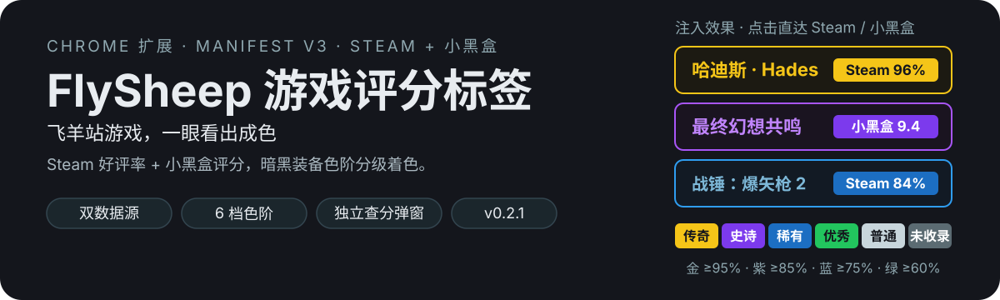
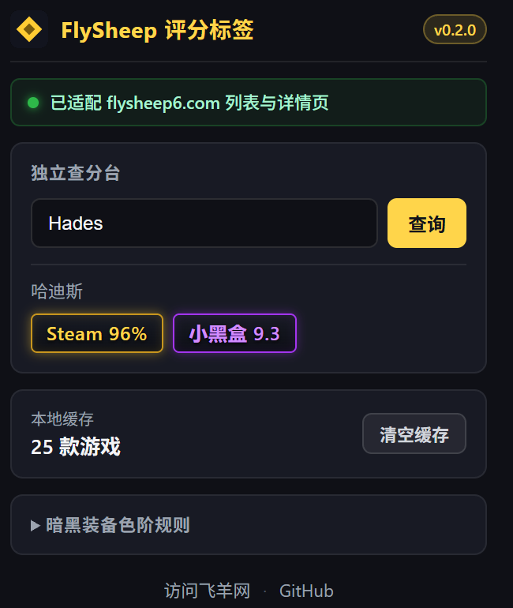

<p align="right"><a href="README.md">中文</a></p>

<p align="center">
  
</p>

<p align="center">
  <a href="https://github.com/holynova/flysheep-game-rating/releases/latest">⬇ Download Extension</a>
  ·
  <a href="https://www.flysheep6.com/">FlySheep Games</a>
  ·
  <a href="https://github.com/holynova/flysheep-game-rating">GitHub Repository</a>
</p>

<p align="center">
  <a href="https://developer.chrome.com/docs/extensions/mv3/intro/"></a>
  <a href="LICENSE"></a>
  <a href="https://github.com/holynova/flysheep-game-rating/releases"></a>
</p>

FlySheep Game Rating is a Chrome / Edge extension (Manifest V3, vanilla JS, zero build) for flysheep6.com: it injects **Steam approval ratings** and **Xiaoheihe (小黑盒) scores** under game titles on list and detail pages, colored by Diablo-style loot tiers. Click a tag to jump to the Steam store or Xiaoheihe game page. A standalone toolbar popup looks up any game by name in seconds.

## Screenshots

<p align="center">
  
</p>

<p align="center">
  
</p>

> Screenshots come from the CDP end-to-end tests in the repo's `docs/` directory, cropped; the popup screenshot shows the v0.2.0 UI, while the current version is v0.2.1.

## Loot Tiers

Tags are colored automatically from the Steam approval rating and review count (or the Xiaoheihe 10-point score, converted):

| Tier | Condition (0–100) | Look | Meaning |
| --- | --- | --- | --- |
| 🟡 **金 · 传奇 (Gold · Legendary)** | ≥95 with ≥500 Steam reviews | Gold glow + highlighted border | Overwhelmingly positive masterpieces (e.g. 《哈迪斯》 Hades, 96%) |
| 🟣 **紫 · 史诗 (Purple · Epic)** | ≥85 with ≥50 Steam reviews | Purple halo | Excellent games (e.g. 《雾锁王国》 Enshrouded, 86%; 《空洞骑士：丝之歌》 Hollow Knight: Silksong, ~90%) |
| 🔵 **蓝 · 稀有 (Blue · Rare)** | ≥75 | Blue border | Worth playing (e.g. 《战锤 40K 爆矢枪 2》 Warhammer 40,000: Space Marine 2, 84%) |
| 🟢 **绿 · 优秀 (Green · Fine)** | ≥60 | Green border | Mostly positive |
| ⚪ **白 · 普通 (White · Common)** | <60 | Plain silver-gray | Mixed or mostly negative (e.g. 《无主之地 4》 Borderlands 4, ~57%) |
| 灰 · 未收录 (Gray · Unlisted) | No match | Dim border | Not on Steam and no Xiaoheihe entry yet |

> The Xiaoheihe API doesn't return review counts, so results matched on Xiaoheihe alone skip the sample-size thresholds and are tiered by score directly. The example ratings were checked on 2026-11-14 and change as new reviews come in.

## Features

- **Smart title cleaning & bilingual cross-platform matching**: strips leading `【…】` / `[…]` tags, emoji crowns, version numbers, "all DLC", localization-group and release-group suffixes (`RUNE`, `TENOKE`, `FLT`, `CODEX`…); the Chinese title takes priority, with the English title in parentheses as fallback; Steam store search cross-indexed with Xiaoheihe `steam_appid`, with matches below score 55 discarded to avoid mismatches.
- **Lightweight, fast, and polite**: a service-worker queue (max 3 concurrent) avoids API 429 rate limits when scrolling fast; local `chrome.storage.local` cache (14-day TTL, max 800 entries) makes refreshes instant.
- **Standalone lookup popup**: click the toolbar icon for a dark lookup panel — type any game name for an instant score, see how many games are cached locally, and clear the cache in one click.
- **Private & clean**: runs fully locally, uploads no web pages or browsing history; only needs the `storage` permission plus access to the official Steam / Xiaoheihe query endpoints.

## Install

### Option 1: Download a packaged release (recommended)

1. Go to [Releases](https://github.com/holynova/flysheep-game-rating/releases) and download the latest `flysheep-game-rating-v*.zip`, then unzip it.
2. Open Chrome / Edge, go to `chrome://extensions`, and turn on 「开发者模式」 ("Developer mode") in the top-right corner.
3. Click 「加载已解压的扩展程序」 ("Load unpacked") and select the unzipped folder (the one containing `manifest.json`).
4. Open [flysheep6.com](https://www.flysheep6.com) (refresh if it's already open) — rating tags render under the titles automatically.

### Option 2: Load from source

```bash
git clone https://github.com/holynova/flysheep-game-rating.git
cd flysheep-game-rating
```

Load that directory in `chrome://extensions` the same way. No npm dependencies, no build step.

## Tech

- Manifest V3, vanilla JS, zero build, zero dependencies; the content script only matches the two `flysheep6.com` domains.
- The rating core is ported from the same author's `game-rating-lookup` (MIT): Steam store search / review-summary APIs cross-indexed with the Xiaoheihe game search API; the Xiaoheihe API needs no Referer.
- Automated tests: end-to-end tests over the Chrome DevTools Protocol (`python scripts/cdp_test.py`, which exercises the list page, detail page, and popup and saves screenshots to `docs/`; `--keep` leaves the browser window open for manual review).

```
manifest.json MV3 manifest (v0.2.1)
icons/ 16 / 48 / 128 px loot-style icons
src/
├── background.js Service Worker: request queue (3 concurrent), local cache (14-day TTL)
├── content.js Content script: title cleaning, MutationObserver dynamic injection
├── ratings.js Rating core: Steam + Xiaoheihe multi-source indexing and tier conversion
├── tags.css Diablo-style loot tier tag styles
├── popup.html/css/js Standalone lookup toolbar popup
scripts/
├── cdp_test.py Fully automated CDP end-to-end tests
├── cdp_detail_shot.py Detail-page title-area screenshots
└── make_icons.py Loot icons generated with the Python standard library only
docs/ Test screenshots and reference material
```

## License

[MIT License](LICENSE) © 2026 [holynova](https://github.com/holynova)
