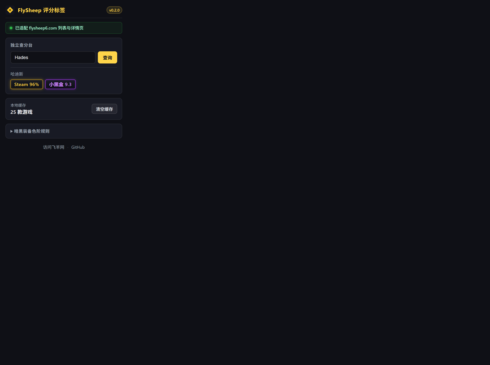

# FlySheep 游戏评分标签 (flysheep-game-rating)

[](https://developer.chrome.com/docs/extensions/mv3/intro/)
[](LICENSE)
[](https://github.com/holynova/flysheep-game-rating/releases)

适用于 Chrome / Edge 等 Chromium 浏览器的轻量扩展（Manifest V3，纯原生 JS，**零构建步骤**）。

为 [flysheep6.com](https://www.flysheep6.com)（飞羊游戏站）的 PC 游戏列表与详情页自动注入 **Steam 好评率** 与 **小黑盒评分** 标签，支持点击直达 Steam 商店 / 小黑盒游戏页，并按**暗黑装备色阶**进行品质分级。

同时提供**独立工具栏弹窗（Popup）**，支持直接输入任意游戏名快速查分、管理本地缓存与查看色阶规则。

---

## 效果演示

| 列表页自动注入评分 | 详情页顶栏评分 | 扩展工具栏查分弹窗 |
|---|---|---|
|  |  |  |

---

## 暗黑装备色阶

根据 Steam 好评率及评测样本量（或小黑盒 10 分制评分折算），标签会自动着色为暗黑风格稀有度装备卡片：

| 色阶 | 条件（百分制） | 视觉效果 | 代表含义 |
|---|---|---|---|
| 🟡 **金 · 传奇** | ≥95 且 Steam 评测数 ≥500 | 金色辉光 + 边框高亮 | 好评如潮级神作（如《战锤40K 爆矢枪2》《血源诅咒》） |
| 🟣 **紫 · 史诗** | ≥85 且 Steam 评测数 ≥50 | 紫色光晕 | 优秀佳作（如《哈迪斯2》《最终幻想 共鸣》《使命召唤》） |
| 🔵 **蓝 · 稀有** | ≥75 | 蓝色边框 | 值得一玩的作品（如《赛博朋克2077》《空洞骑士 丝之歌》） |
| 🟢 **绿 · 优秀** | ≥60 | 绿色边框 | 褒贬偏正面（如《雾锁王国》《不朽遗志》） |
| ⚪ **白 · 普通** | <60 | 银灰素色 | 褒贬不一或偏负面（如《无主之地4》《恶魔城》） |
| 灰 · 未收录 | 无匹配结果 | 灰暗边框 | 尚未上架 Steam 且小黑盒未建词条 |

> 注：小黑盒接口不直接返回打分数，对小黑盒单独匹配的结果自动放行样本数门槛，直接依据分数定级。

---

## 核心特性

1. **智能标题清洗与双语跨平台匹配**：
   - 自动剥离 `【VBS】`、`【无需虚拟机】`、`[PC]`、Emoji 皇冠与版本号、全DLC、汉化组、破解发布组（`RUNE`、`TENOKE`、`FLT`、`CODEX` 等）后缀；
   - 中文游戏主名优先，括号内英文候选兜底；
   - 采用 Steam 商店搜索与小黑盒 `steam_appid` 交叉索引引擎，大幅提高中英文游戏匹配准确率。
2. **轻量极速，低频控风险**：
   - Service Worker 后台并发队列控制（最多 3 并发），避免快速滑屏触发 API 429 频控；
   - 本地 `chrome.storage.local` 缓存（14 天 TTL，最多 800 条），页面刷新瞬间出结果。
3. **独立查分弹窗（Popup）**：
   - 点击浏览器工具栏图标即可打开暗色查分台，输入任何游戏名即可秒级出分；
   - 实时查看本地已缓存游戏数量，一键清空缓存。
4. **隐私与纯净**：
   - 纯本地运行，不上传任何用户网页或浏览历史数据；
   - 仅需 `storage` 权限及 Steam / 小黑盒官方查询接口权限。

---

## 安装方法

### 方式一：下载已打包发布版本（推荐）

1. 前往 [Releases 发布页面](https://github.com/holynova/flysheep-game-rating/releases) 下载最新版的 `flysheep-game-rating-v*.zip` 并解压。
2. 打开 Chrome / Edge 浏览器，地址栏输入 `chrome://extensions` 并回车。
3. 开启右上角的「**开发者模式**」。
4. 点击左上角的「**加载已解压的扩展程序**」，选择解压后的文件夹（包含 `manifest.json` 的目录）。
5. 打开 [flysheep6.com](https://www.flysheep6.com)，标题下方即会自动渲染评分标签。

### 方式二：从源码加载

```bash
git clone https://github.com/holynova/flysheep-game-rating.git
cd flysheep-game-rating
```

同样在 `chrome://extensions` 中加载该目录即可。

---

## 目录结构

```text
manifest.json          MV3 清单配置
icons/                 16 / 48 / 128 px 装备风图标
src/
  ├── background.js    Service Worker：请求队列（并发3）、本地缓存（14天TTL）
  ├── content.js       内容脚本：标题清洗、MutationObserver 动态注入
  ├── ratings.js       评分查询核心：Steam + 小黑盒多路索引与色阶换算
  ├── tags.css         暗黑装备色阶标签样式
  ├── popup.html       独立查分工具栏弹窗结构
  ├── popup.css        弹窗暗色视觉规范
  └── popup.js         弹窗查分与缓存管理逻辑
scripts/
  ├── cdp_test.py      基于 Chrome DevTools Protocol 的全自动化端到端测试
  ├── make_icons.py    纯 Python 标准库生成装备图标
  └── make-icons.ps1   PowerShell 图标生成辅助
docs/                  测试截图与参考资料
```

---

## 自动化测试与验证

本项目内置无需第三方大型测试框架的 CDP 自动化端到端测试工具：

```bash
python scripts/cdp_test.py          # 启动独立 Chrome 实测列表页、详情页与 Popup 弹窗
python scripts/cdp_test.py --keep   # 测试完成后保留浏览器窗口供人工审阅
```

---

## 许可证

[MIT License](LICENSE) © 2026 [holynova](https://github.com/holynova)
