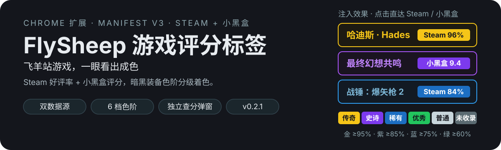
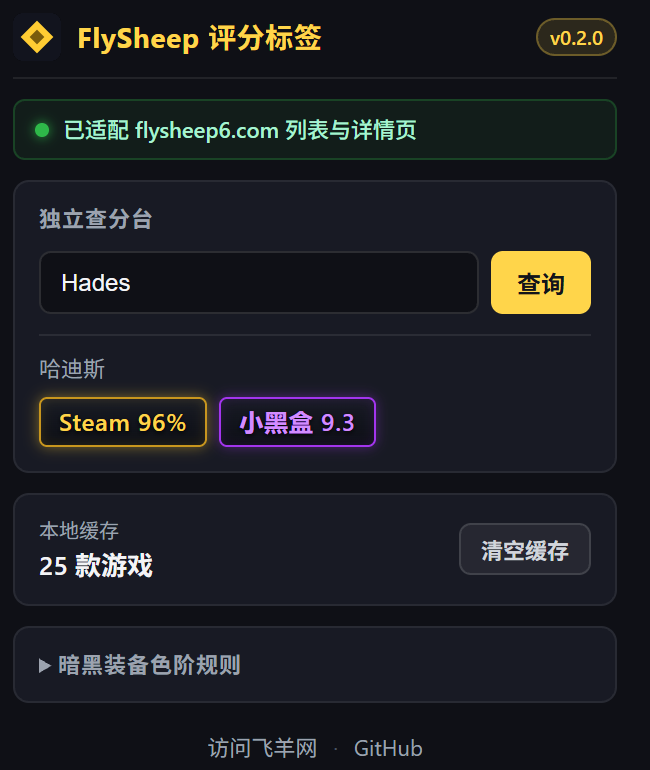

<p align="center">

</p>

<p align="center">
<a href="https://github.com/holynova/flysheep-game-rating/releases/latest">⬇ 下载扩展 Download</a>
·
<a href="https://www.flysheep6.com/">飞羊游戏站</a>
·
<a href="https://github.com/holynova/flysheep-game-rating">GitHub 仓库</a>
</p>

<p align="center">
<a href="https://developer.chrome.com/docs/extensions/mv3/intro/"></a>
<a href="LICENSE"></a>
<a href="https://github.com/holynova/flysheep-game-rating/releases"></a>
</p>

FlySheep 游戏评分标签是一款 Chrome / Edge 扩展（Manifest V3，纯原生 JS，零构建）：为飞羊游戏站（flysheep6.com）的 PC 游戏列表与详情页自动注入 **Steam 好评率**与**小黑盒评分**标签，点击直达 Steam 商店 / 小黑盒游戏页，并按暗黑装备色阶分级着色。另有独立查分弹窗，输入任意游戏名秒级出分。

A Chrome / Edge extension (Manifest V3, vanilla JS, zero build) that injects **Steam approval ratings** and **Xiaoheihe (小黑盒) scores** into game list and detail pages on flysheep6.com, colored by Diablo-style loot tiers. Click a tag to jump to the Steam store or Xiaoheihe game page. A standalone toolbar popup looks up any game by name.

## 截图 / Screenshots

<p align="center">

</p>

<p align="center">

</p>

> 截图来自仓库 `docs/` 的 CDP 端到端测试，已裁剪；弹窗截图为 v0.2.0 界面，当前版本 v0.2.1。

## 暗黑装备色阶 / Loot Tiers

根据 Steam 好评率及评测样本量（或小黑盒 10 分制评分折算），标签自动着色：

| 色阶 | 条件（百分制） | 视觉效果 | 代表含义 |
| --- | --- | --- | --- |
| 🟡 **金 · 传奇** | ≥95 且 Steam 评测数 ≥500 | 金色辉光 + 边框高亮 | 好评如潮级神作（如《哈迪斯》96%） |
| 🟣 **紫 · 史诗** | ≥85 且 Steam 评测数 ≥50 | 紫色光晕 | 优秀佳作（如《雾锁王国》86%、《空洞骑士：丝之歌》约 90%） |
| 🔵 **蓝 · 稀有** | ≥75 | 蓝色边框 | 值得一玩的作品（如《战锤 40K 爆矢枪 2》84%） |
| 🟢 **绿 · 优秀** | ≥60 | 绿色边框 | 褒贬偏正面 |
| ⚪ **白 · 普通** | <60 | 银灰素色 | 褒贬不一或偏负面（如《无主之地 4》约 57%） |
| 灰 · 未收录 | 无匹配结果 | 灰暗边框 | 尚未上架 Steam 且小黑盒未建词条 |

> 小黑盒接口不直接返回打分数，对小黑盒单独匹配的结果自动放行样本数门槛，直接依据分数定级。举例游戏的好评率以 2026-11-14 核查为准，评分会随新评测变化。

## 核心特性 / Features

- **智能标题清洗与双语跨平台匹配**：自动剥离 ``、``、`[PC]`、Emoji 皇冠与版本号、全 DLC、汉化组、破解发布组（`RUNE`、`TENOKE`、`FLT`、`CODEX` 等）后缀；中文游戏主名优先，括号内英文候选兜底；Steam 商店搜索与小黑盒 `steam_appid` 交叉索引，匹配分数低于 55 的结果直接丢弃，避免张冠李戴。
- **轻量极速，低频控风险**：Service Worker 后台并发队列控制（最多 3 并发），避免快速滑屏触发 API 429 频控；本地 `chrome.storage.local` 缓存（14 天 TTL，最多 800 条），页面刷新瞬间出结果。
- **独立查分弹窗**：点击浏览器工具栏图标打开暗色查分台，输入任何游戏名秒级出分；实时查看本地已缓存游戏数量，一键清空缓存。
- **隐私与纯净**：纯本地运行，不上传任何用户网页或浏览历史数据；仅需 `storage` 权限及 Steam / 小黑盒官方查询接口权限。

## 安装 / Install

### 方式一：下载已打包发布版本（推荐）

1. 前往 [Releases](https://github.com/holynova/flysheep-game-rating/releases) 下载最新版的 `flysheep-game-rating-v*.zip` 并解压。
2. 打开 Chrome / Edge，地址栏输入 `chrome://extensions`，开启右上角的「开发者模式」。
3. 点击「加载已解压的扩展程序」，选择解压后的文件夹（包含 `manifest.json` 的目录）。
4. 打开 [flysheep6.com](https://www.flysheep6.com)（页面已打开时请刷新一次），标题下方即自动渲染评分标签。

### 方式二：从源码加载

```bash
git clone https://github.com/holynova/flysheep-game-rating.git
cd flysheep-game-rating
```

同样在 `chrome://extensions` 中加载该目录即可。无 npm 依赖、无构建步骤。

## 技术 / Tech

- Manifest V3，纯原生 JS，零构建、零依赖；内容脚本只匹配 `flysheep6.com` 两个域名。
- 评分核心移植自同一作者的 `game-rating-lookup`（MIT）：Steam 商店搜索 / 评测摘要接口 + 小黑盒游戏搜索接口交叉索引；小黑盒 API 无需 Referer。
- 自动化测试：基于 Chrome DevTools Protocol 的端到端测试（`python scripts/cdp_test.py`，实测列表页、详情页与 Popup 弹窗并截图到 `docs/`；`--keep` 保留浏览器窗口供人工审阅）。

```
manifest.json MV3 清单配置（v0.2.1）
icons/ 16 / 48 / 128 px 装备风图标
src/
├── background.js Service Worker：请求队列（并发 3）、本地缓存（14 天 TTL）
├── content.js 内容脚本：标题清洗、MutationObserver 动态注入
├── ratings.js 评分查询核心：Steam + 小黑盒多路索引与色阶换算
├── tags.css 暗黑装备色阶标签样式
├── popup.html/css/js 独立查分工具栏弹窗
scripts/
├── cdp_test.py CDP 全自动化端到端测试
├── cdp_detail_shot.py 详情页标题区定位截图
└── make_icons.py 纯 Python 标准库生成装备图标
docs/ 测试截图与参考资料
```

## English

**FlySheep Game Rating** is a Chrome / Edge extension (Manifest V3, vanilla JS, zero build) for flysheep6.com: it injects Steam approval ratings and Xiaoheihe scores under game titles on list and detail pages, colored by Diablo-style loot tiers (gold ≥95% with 500+ reviews, purple ≥85%, blue ≥75%, green ≥60%, white below, gray when unlisted). Tags link straight to the Steam store or Xiaoheihe page.

- **Smart title cleaning**: strips ``, version numbers, "all DLC", release-group tags (`RUNE`, `TENOKE`, `FLT`, `CODEX`…); Chinese title first, English in parentheses as fallback; cross-indexed Steam search + Xiaoheihe `steam_appid`, with matches below score 55 discarded.
- **Fast & polite**: service-worker queue (max 3 concurrent) avoids API 429s; local cache (14-day TTL, max 800 entries) makes refreshes instant.
- **Popup**: look up any game by name from the toolbar, see cache size, clear cache in one click.
- **Privacy**: runs fully locally, uploads nothing; only the `storage` permission plus Steam/Xiaoheihe query hosts.
- **Install**: download the ZIP from [Releases](https://github.com/holynova/flysheep-game-rating/releases), enable Developer Mode at `chrome://extensions`, and load the unpacked folder.

## 许可 / License

[MIT License](LICENSE) © 2026 [holynova](https://github.com/holynova)
